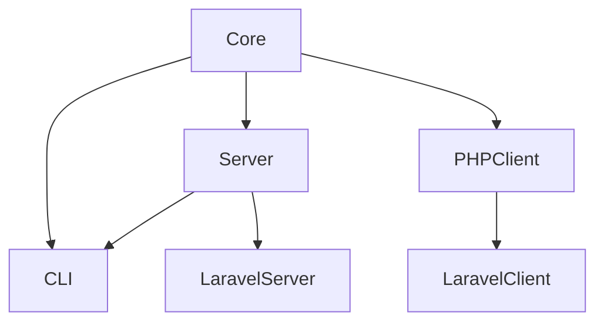

# ProIT365 MultiKey Auth Packaging Audit

## Final status — Batches 1–6

**Status:** All remaining local preparation and validation batches are complete.  
**Repository:** `proit365/multikey-auth` monorepo, branch `main`.
**Audit baseline:** `53632e8`. **Current owner-authored commit:** `a0be5e4`.
**Audit date:** 2026-11-22.

This report distinguishes **VERIFIED** facts (confirmed from files or executed commands), **INFERRED** interpretations, **PLANNED** work described in project materials, and **UNKNOWN** items that cannot be established locally. No credentials or secret values are included.

The original repository baseline was collected before implementation began.
The final outcomes and remaining external blockers below supersede any
batch-one observations that have since been resolved.

## 1. Executive summary

- **VERIFIED:** The six Composer manifests use the intended `proit365` package names. Clean local consumer installs resolved all six Composer packages; Laravel resolution and Testbench suites passed after the firewall check.
- **VERIFIED:** Strict Composer validation, PHP smoke tests, Core and CLI tests, JavaScript interoperability tests, Flutter analysis/tests, and a pub.dev dry-run all passed.
- **VERIFIED:** All six package roots now have MIT license text and README documentation. Composer manifests now include package keywords and source/support links.
- **VERIFIED:** The PHP-client distribution mapping is aligned across the split script, release documentation, and `update.bat`: its Composer name is `proit365/multikey-auth`, while its distinct distribution repository is `proit365/multikey-auth-php-client`.
- **VERIFIED:** All six committed package prefixes split to root trees matching their source prefix trees. No refs were pushed or created.
- **VERIFIED:** No Git tags are present. Internal dependencies require `^1.0`; stable publication therefore needs compatible package tags/releases before dependent packages can resolve from Packagist.
- **UNKNOWN / NOT PERFORMED:** Distribution repositories, Packagist registration, npm/pub.dev publication, GitHub releases, and external installation from published repositories remain unverified. No remote action was attempted.

## 2. Repository and Git baseline

### Top-level structure

| Path | Purpose |
|---|---|
| `database/` | Database-related schemas and migration assets used by the implementation and examples. |
| `docs/` | Project and implementation documentation. |
| `examples/` | Demonstrations, including the end-to-end example. |
| `packages/` | The six independently distributable Composer package source trees. |
| `specification/` | Protocol specification and supporting normative material. |
| `tests/` | Monorepo-level smoke and integration checks. |
| `tools/` | Release and repository tooling, including subtree split support. |
| Root files | Project guidance, changelog/release material, security/threat-model documents, root MIT license, and `composer.dev.json`. |

There is no root `composer.json`; `composer.dev.json` is the development workspace manifest. No website directory is present in this repository.

### Git and release state

- **VERIFIED:** The working tree was clean at audit start on `main`, HEAD `53632e8`, with no local tags. The owner later committed the preparation as `a0be5e4`; it has not been pushed.
- **VERIFIED:** The main monorepo is the development source. Package directories are the sources for subtree splits. Split trees were computed from committed HEAD for verification; no split push or remote action was run.
- **VERIFIED:** The separate `update.bat` helper stages all changes, commits and pushes `main`, then pushes package splits. It was inspected but not run. Its broad staging and automatic push behavior makes it unsuitable as an unattended release command without further safeguards.
- **INFERRED:** `git subtree split` produces a package-root history from tracked files and preserves relevant package history; ignored/untracked local files are not part of that split.

## 3. Package inventory and dependency graph

| Package directory | Composer package / intended distribution repository | Purpose, namespace and dependencies | Tests and validation |
|---|---|---|---|
| `packages/core` | `proit365/multikey-auth-core` / `proit365/multikey-auth-core` | Framework-independent cryptographic core. PSR-4: `ProIT365\MultiKeyAuth\Core\` → `src/`. PHP `^8.2`, `ext-openssl`; PDO and mysqli are suggestions for optional repository implementations. | PHPUnit is declared; **VERIFIED:** 9 tests, 20 assertions passed. README and MIT license are present. |
| `packages/server` | `proit365/multikey-auth-server` / `proit365/multikey-auth-server` | Challenge issuer and verifier. PSR-4 currently maps `ProIT365\MultiKeyAuth\Core\Server\` → `src/Server/`; confirm this public namespace before changing because renaming is a compatibility break. Requires Core `^1.0`; PDO is suggested. | No Composer test script or dev test dependency is declared. Monorepo smoke coverage exists. README and MIT license are present. |
| `packages/client-php` | `proit365/multikey-auth` / `proit365/multikey-auth-php-client` | PHP client SDK. PSR-4: `ProIT365\MultiKeyAuth\Client\` → `src/`. Requires PHP `^8.2` and Core `^1.0`. | No package-specific Composer test script; monorepo manual/integration checks and consumer installation/autoload were verified. README and MIT license are present. |
| `packages/laravel-server` | `proit365/laravel-multikey-auth-server` / `proit365/laravel-multikey-auth-server` | Laravel 12 server adapter. PSR-4: `ProIT365\MultiKeyAuth\LaravelServer\` → `src/`. Requires PHP `^8.2`, `ext-pdo`, Illuminate cache/console/database/routing/support `^12.0`, and Server `^1.0`. Test dependencies: Testbench `^10.0`, PHPUnit `^11.5`; provider is registered in Composer metadata. | Clean local consumer install passed; Testbench suite passed (2 tests, 9 assertions). README and MIT license are present. |
| `packages/laravel-client` | `proit365/laravel-multikey-auth` / `proit365/laravel-multikey-auth` | Laravel 12 client integration. PSR-4: `ProIT365\MultiKeyAuth\LaravelClient\` → `src/`. Requires PHP `^8.2`, Illuminate HTTP/support `^12.0`, and PHP Client `^1.0`. Testbench `^10.0`, PHPUnit `^11.5`; provider and facade alias are declared. | Clean local consumer install passed; Testbench suite passed (4 tests, 6 assertions). README and MIT license are present. |
| `packages/cli` | `proit365/multikey-auth-cli` / `proit365/multikey-auth-cli` | Framework-independent administrative CLI. PSR-4: `ProIT365\MultiKeyAuth\Cli\` → `src/`; Composer binary `bin/mkap`. Requires PHP `^8.2`, `ext-pdo`, Core `^1.0`, and Server `^1.0`. | Standalone checkout install, `composer test`, and executable help passed. README now documents only supported development JSON exports; MIT license is present. |

The internal dependency order is:

All six package manifests declare `license: MIT` and now have package-root `LICENSE` and `README.md` files in the local worktree. Each manifest points `homepage` at the main monorepo; package-specific keywords and support links now identify source/docs/issues there. None of the package manifests has a `composer.lock`. Library lockfiles are not normally published; reproducible monorepo development is instead affected by the lack of a tracked lockfile for `composer.dev.json`.

## 4. Composer resolution and release prerequisites

- **VERIFIED:** `composer.dev.json` defines local path repositories for all six packages, with symlinking enabled and each package assigned `1.0.x-dev`. It sets `minimum-stability: dev` and `prefer-stable: true` for the development workspace.
- **VERIFIED:** Published package manifests use internal `^1.0` constraints and contain no monorepo-relative path repositories. This is the correct separation for Packagist consumers.
- **VERIFIED:** All package names and internal dependency names match the requested Composer identities.
- **INFERRED:** Before stable publication, release at least Core `1.0.0`; then Server and PHP Client; then CLI and the corresponding Laravel adapters once their direct dependencies have compatible stable releases. The exact tag/release sequence should follow the final test and release policy.
- **UNKNOWN:** Packagist availability, package registration, and clean installs from actual GitHub distribution repositories cannot be verified before those repositories and packages exist.
- **VERIFIED — RESOLVED:** The split script and release mapping now use `proit365/multikey-auth-php-client` for the PHP-client repository while retaining Composer package name `proit365/multikey-auth`. The same mapping is present in `update.bat`.
- **VERIFIED — RESOLVED:** Each of the six package roots now includes an exact copy of the root MIT license, so package-root splits carry the license text.

### Initial standalone-install check (Batch 1)

**VERIFIED:** The consumer test exported only tracked package files from HEAD via `git archive`, configured Composer with Packagist disabled and an isolated `COMPOSER_HOME`, then installed Core, Server, PHP Client, and CLI from local path repositories. Composer resolved all four; the four representative PSR-4 namespaces autoloaded; `php vendor/bin/mkap help` exited successfully.

This checks package-root structure, autoload metadata, internal dependency resolution, and the Composer binary proxy without network access. It does **not** prove Packagist installation, GitHub repository configuration, stable-version availability, or Laravel package installation.

**VERIFIED local workspace caveat:** A first mirror test against the live working tree copied an ignored, untracked `packages/core/vendor` directory into the temporary consumer. The successful check was rerun from a `git archive` of tracked files, excluding that local directory. The working package tree was left untouched, and both temporary consumer directories were removed. The local workspace's `composer.dev.json` uses symlinks, but tests intended to represent published contents should use a clean tracked export.

## 5. Non-Composer distribution channels

- **JavaScript — VERIFIED:** `packages/javascript/package.json` names the package
  `@proit365/multikey-auth`, identifies `packages/javascript` in the monorepo,
  and runs `node test/interoperability.test.js`. That test passed. No npm
  publication or package identity change was performed. Its declared Node
  engine floor remains `>=12`; review that support floor before a future npm
  release.
- **Flutter/Dart — VERIFIED:** `packages/flutter/pubspec.yaml` names the package
  `proit365_multikey_auth`, declares Dart `>=3.3.0 <4.0.0` and Flutter
  `>=3.19.0`, and links the monorepo and issue tracker. `publish_to` is omitted,
  so pub.dev remains the default registry. Analysis and tests passed, and
  `flutter pub publish --dry-run` reported zero warnings. No publication
  occurred.
- **VERIFIED:** No GitHub Actions publishing workflow was added. The documented
  local split script remains the release path; registry publication is a
  separate owner action.

## 6. Findings and required follow-up

| Priority / status | Finding | Evidence | Follow-up |
|---|---|---|---|
| Resolved (High) | Package distribution trees initially omitted license text. | Added MIT `LICENSE` files to all six package roots; byte comparison against root license passed. | Complete. |
| Resolved (High) | PHP-client target initially conflicted with the main monorepo. | Split script, release map, and `update.bat` now point to `proit365/multikey-auth-php-client`. | Complete; external repository creation remains owner action. |
| Resolved (High) | CLI README described protected exports as a production option although code rejects them. | README now states that only plaintext `--development-json` exports are supported and must remain development-only. | Complete; implementation behavior was not changed. |
| Resolved (Medium) | Package docs lacked consistent install/support information; Core had no README. | All six package roots now have README files with requirements/install guidance, plus package-specific metadata and support links. | Complete. |
| Resolved (Medium) | Root README was UTF-16LE and contained stale usage/license claims. | Normalized to UTF-8 and linked to the implemented PHP SDK guide and root MIT license. | Complete. |
| Pending (Medium) | A stable consumer installation from Packagist cannot yet be demonstrated. | No package tags or public distribution repositories exist; package constraints use `^1.0`. | Owner must approve versions, create repositories, release dependency tags, then verify registry installs. |
| Pending decision (Medium) | Server's namespace retains `Core\Server` despite its separate package boundary. | `packages/server/composer.json` maps `ProIT365\MultiKeyAuth\Core\Server\` to `src/Server/`. | Confirm this public namespace; do not rename without a compatibility decision. |
| Operational risk (Medium) | The parent `update.bat` stages and pushes broadly without test/version safeguards. | `../update.bat:43,57,75-100` stages all changes, pushes `main`, and pushes package splits. | Do not run as the release path; use the scoped split script after review. The helper is outside this repository and was not changed. |
| Resolved (Low) | Package metadata lacked keywords and support links. | All six manifests now declare package-specific keywords plus monorepo issues/source/docs links. The monorepo homepage is retained intentionally as the source of truth. | Complete. |
| Pending (Low) | Parent project instructions retain provisional `realmatrix` names. | `../AI_PROJECT_INSTRUCTIONS.json` uses older names; the manifests and confirmed map use `proit365`. | Keep future instruction material aligned; not changed because it is outside the repository. |
| Pending review (Low) | JavaScript package declares Node `>=12`. | `packages/javascript/package.json`; current npm interoperability test passes. | Review the supported Node floor before a future npm release; no compatibility change was made here. |

The package-root manual/integration checks for PHP Client and the Laravel adapters are monorepo-oriented; they should not be confused with portable package test suites. The initial Laravel consumer attempt hit Packagist TLS `curl error 60`; after the firewall check, clean temporary consumer installs and both Testbench suites passed with TLS verification enabled. Published-registry installs remain unverified until distribution repositories and package tags exist.

## 7. Validation record

The first rows below record Batch 1 and remain valid. Results from the
remaining batches are recorded in the completion table that follows.

| Check | Result |
|---|---|
| Strict Composer manifest validation: `composer.dev.json`, six package manifests, and `examples/end-to-end/composer.json` | **PASS** |
| `php tests/phase13-smoke.php` | **PASS** |
| Core PHPUnit | **PASS** — 9 tests, 20 assertions |
| Local consumer install from tracked package trees: Core, Server, PHP Client, CLI | **PASS** — local path repositories; Packagist disabled |
| Consumer PSR-4 autoload check for the four installed packages | **PASS** |
| Installed Composer CLI proxy, `php vendor/bin/mkap help` | **PASS** |
| Laravel Testbench suites / consumer install | **NOT RUN** — external dependency resolution unavailable in this batch |
| `update.bat`, release pushes, GitHub repository creation, Packagist registration/publication | **NOT RUN** |

### Batches 2–6 validation

| Check | Result |
|---|---|
| Strict Composer validation after metadata changes | **PASS** — all eight manifests |
| `php tests/phase13-smoke.php` | **PASS** — package smoke checks and PHP lint checks |
| Core `composer test` | **PASS** — 9 tests, 20 assertions |
| CLI `composer test` in monorepo and flattened standalone checkout | **PASS** |
| Standalone CLI package install and `php bin/mkap help` | **PASS** |
| Local consumer installation from clean package copies: Core, Server, PHP Client, CLI | **PASS** — no Packagist access; autoload and Composer binary proxy verified |
| Laravel server consumer install and Testbench | **PASS** — 2 tests, 9 assertions; TLS verification enabled |
| Laravel client consumer install and Testbench | **PASS** — 4 tests, 6 assertions; TLS verification enabled |
| `npm --prefix packages/javascript test` | **PASS** — JavaScript interoperability |
| `flutter analyze --no-pub` and `flutter test --no-pub` | **PASS** |
| `flutter pub publish --dry-run` | **PASS** — package validation reported 0 warnings; no publication occurred |
| `bash -n` and split-script `--help` | **PASS** |
| `git subtree split` for each committed package prefix at HEAD `53632e8` | **PASS** — each split tree matched its source prefix tree; no refs were pushed or created |
| `git diff --check` | **PASS** |
| Full release-script preview, `--package all`, at owner commit `a0be5e4` | **PASS** — all six package splits and safety preflights completed without `--push` |

Two preliminary standalone CLI harness attempts exposed harness setup mistakes:
one disallowed the local `1.0.x-dev` path versions, and one placed the package
inside a monorepo-shaped temporary path so the test intentionally selected its
monorepo schema comparison. Both were corrected; the flattened standalone
checkout test passed. The Laravel TLS failure is an environment/dependency
resolution issue that was resolved after the firewall check; the retry passed
with TLS verification enabled.

## 8. Completed batches and files changed

| Batch | Outcome |
|---|---|
| 1 — Repository/package baseline | Completed. |
| 2 — Package licenses and Core documentation | Added MIT license files to all six package roots and created the Core README. |
| 3 — CLI documentation and executable behavior | Corrected the protected-export claims; standalone install, test script, and executable help passed. No cryptographic or CLI runtime behavior was changed. |
| 4 — Package documentation and Composer metadata | Added/updated package READMEs with the official website and support links, plus Composer keyword metadata; normalized the root README and corrected stale usage/license claims. |
| 5 — Standalone package validation | Validated all six Composer packages locally; Laravel server/client installs and Testbench tests passed after firewall inspection. JavaScript and Flutter checks passed. |
| 6 — Release mapping and final audit | Corrected the PHP-client target, documented tag/release workflow, strengthened split exclusions, and verified committed subtree projections. |

Files changed or added:

- `README.md`, `RELEASE_CHECKLIST.md`
- `packages/{core,server,client-php,laravel-server,laravel-client,cli}/LICENSE`
- `packages/core/README.md`; updated README files in the other five Composer packages
- Composer metadata in all six package `composer.json` files
- `tools/release/split-packages.sh`, `tools/release/README.md`
- `PACKAGING-AUDIT-REPORT.md`, `packaging-audit-progress.json`

No runtime source, protocol, or cryptographic code was changed. The repository
owner committed the preparation as `a0be5e4`; I did not create or amend that
commit. No pushes, tags, remote repository changes, package registrations, or
publications were performed. The post-commit test-result and audit-metadata
updates are local and uncommitted.

## 9. Remaining owner actions and limitations

1. Approve package versions and create the six distribution repositories, including
   `proit365/multikey-auth-php-client`; none exists or was created by this work.
2. Verify published Packagist installs and registry dependency tags after the
   distribution repositories are created; local Laravel/Testbench checks now pass.
3. Confirm whether `ProIT365\MultiKeyAuth\Core\Server\` is the intended public
   Server namespace; changing it later would be a compatibility decision.
4. Review and commit the post-commit audit metadata updates, then inspect the
   six split outputs from the successful preview before any push.
5. After owner approval, release in dependency order, register the Composer
   repositories on Packagist, and optionally create GitHub Releases from verified
   tags. JavaScript and Flutter publication remain separate.

No packages have been published. The monorepo remains the only development
source of truth.
